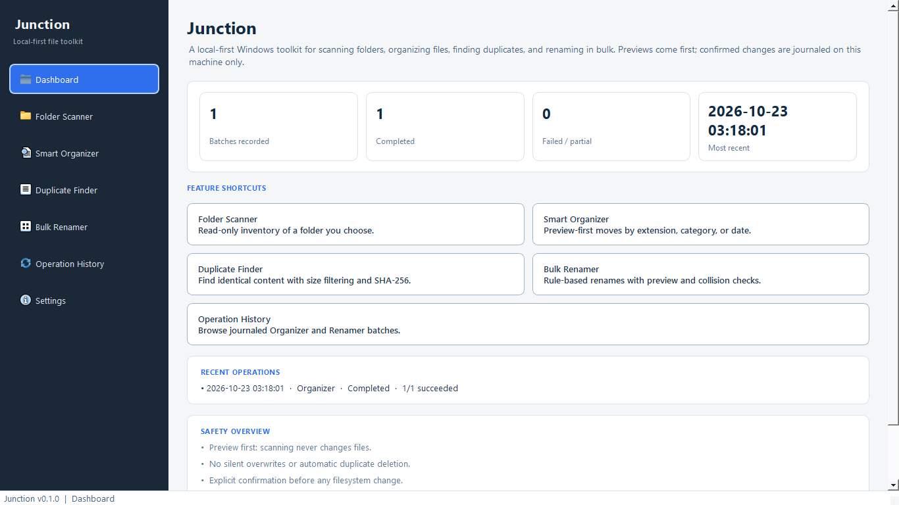
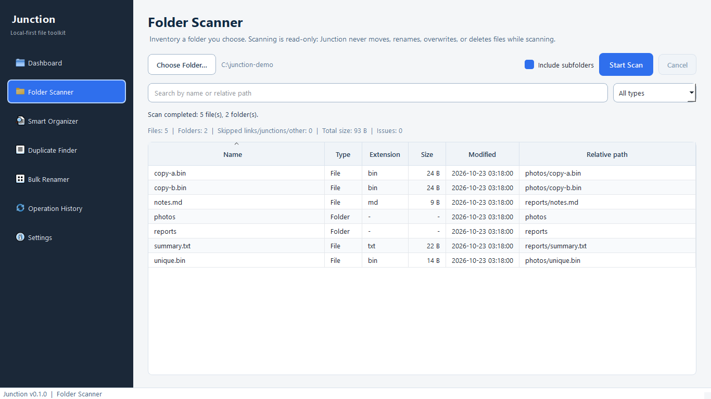
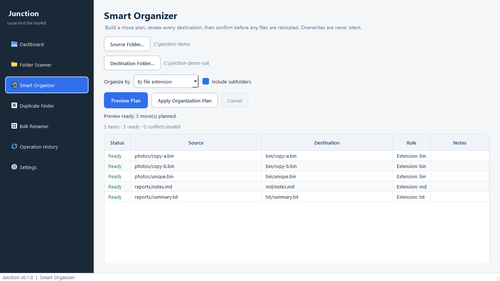
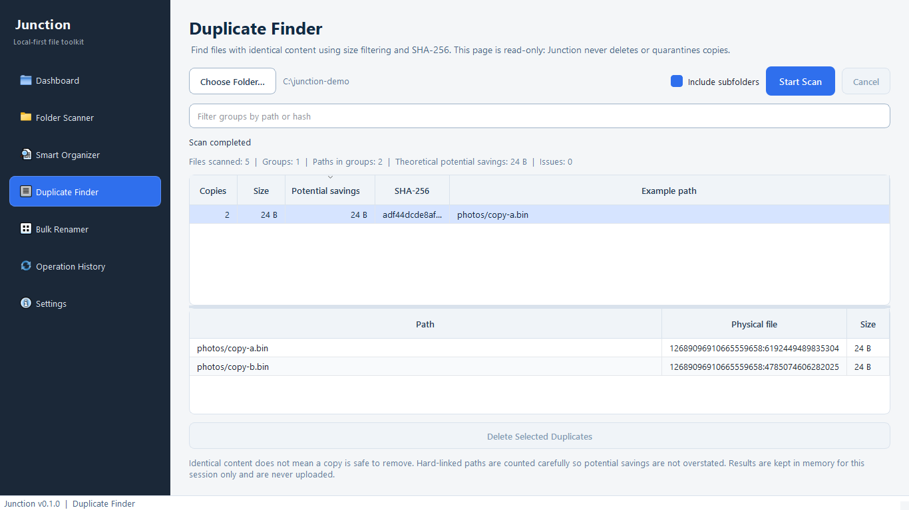
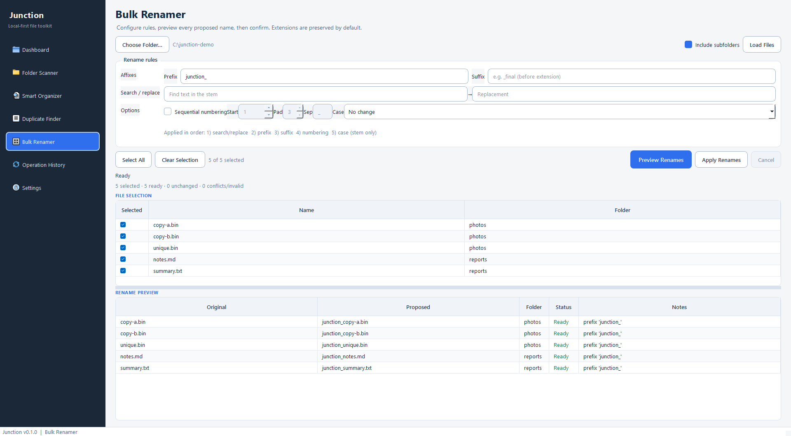
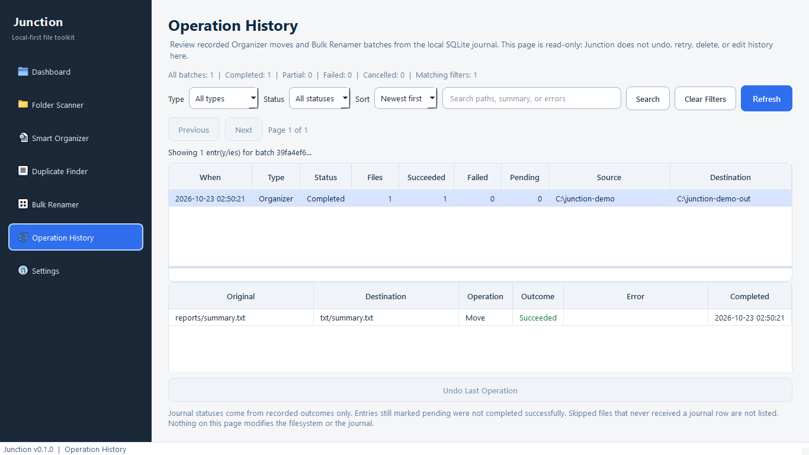

# Junction

Local-first Windows desktop toolkit for scanning folders, organizing files, finding duplicates, and renaming in bulk, with preview-first safety and a SQLite operation journal.

**Stack:** Python 3.13 · PySide6 · SQLite · pytest · Ruff
**Status:** Milestone 7 (UI polish, Junction branding, and portfolio readiness). Packaging is not included yet.
**Repository:** [github.com/devtdlv/junction](https://github.com/devtdlv/junction)

## Overview

Junction is for people who want practical file management on their own PC without cloud sync, telemetry, or silent filesystem changes. Scanning and duplicate detection stay read-only. Smart Organizer and Bulk Renamer require an explicit preview and confirmation before anything moves or renames. Confirmed changes are recorded in a local journal you can browse in Operation History.

The installable Python package name remains `fileforge` (launch with `python -m fileforge`). Product branding in the UI and documentation is **Junction**.

## Features

| Feature | What it does |
|---------|----------------|
| **Folder Scanner** | Read-only inventory of names, sizes, and modified times |
| **Smart Organizer** | Preview-first moves by extension, category, or year/month |
| **Duplicate Finder** | Size filtering + SHA-256 grouping (detection only) |
| **Bulk Renamer** | Configurable rules, collision checks, preview, then confirm |
| **Operation History** | Read-only browser for journaled Organizer and Renamer batches |
| **Dashboard** | Junction introduction, feature shortcuts, and real journal stats |

## Screenshots

Authentic captures from the running PySide6 application (disposable demo files only). No AI-generated mockups.

| Dashboard | Folder Scanner |
|-----------|----------------|
|  |  |

| Smart Organizer | Duplicate Finder |
|-----------------|------------------|
|  |  |

| Bulk Renamer | Operation History |
|--------------|-------------------|
|  |  |

To regenerate screenshots locally:

```powershell
.\.venv\Scripts\python.exe tools\capture_portfolio_screenshots.py
```

## Safety philosophy

- Local-first: data stays on this machine
- Read-only Folder Scanner and Duplicate Finder
- Preview before any Organizer move or Bulk Renamer apply
- Collision detection with no silent overwrites
- Explicit confirmation before modifying files
- SQLite journal for confirmed Organizer and Renamer batches
- No automatic duplicate deletion
- Undo is not implemented yet (Operation History is browse-only)

## Installation (Windows)

Requires Python **3.13** on Windows 10 or later.

```powershell
py -3.13 -m venv .venv
.\.venv\Scripts\python.exe -m pip install --upgrade pip
.\.venv\Scripts\python.exe -m pip install -e ".[dev]"
.\.venv\Scripts\python.exe --version
```

Launch:

```powershell
.\.venv\Scripts\python.exe -m fileforge
```

## Testing

```powershell
.\.venv\Scripts\python.exe -m pytest
.\.venv\Scripts\python.exe -m ruff check .
```

## Architecture

- **PySide6 UI** with sidebar navigation and per-feature pages
- **Pure-Python services** for scanning, planning, hashing, renaming, and history queries
- **Background workers** (`QThread`) so long scans do not freeze the GUI
- **SQLite** settings store and operation journal under `%LOCALAPPDATA%\FileForge\` (legacy folder name kept so existing history remains accessible after the Junction rename)

See [docs/ARCHITECTURE.md](docs/ARCHITECTURE.md) and [docs/USER_GUIDE.md](docs/USER_GUIDE.md).

## Limitations

- No undo / redo of past operations
- Duplicate Finder does not delete or quarantine files
- No packaged Windows executable yet (run from source)
- Primary testing target is Windows
- Scanner and Duplicate Finder results are session-only (not journaled)

## Roadmap

- Windows executable packaging and release validation (Milestone 8)
- Optional future enhancements: undo when safe, richer settings, storage insights

## License

MIT
